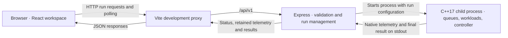
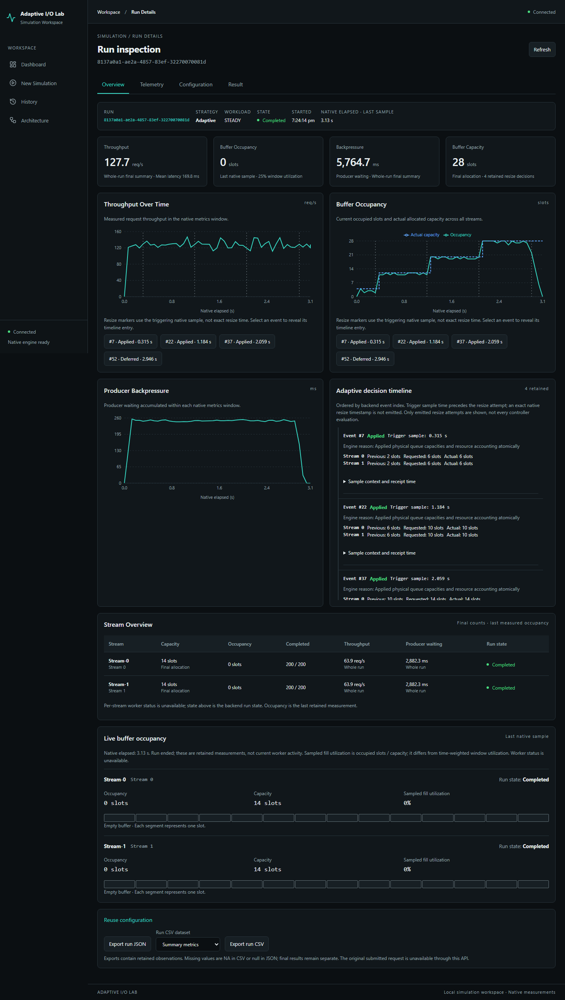
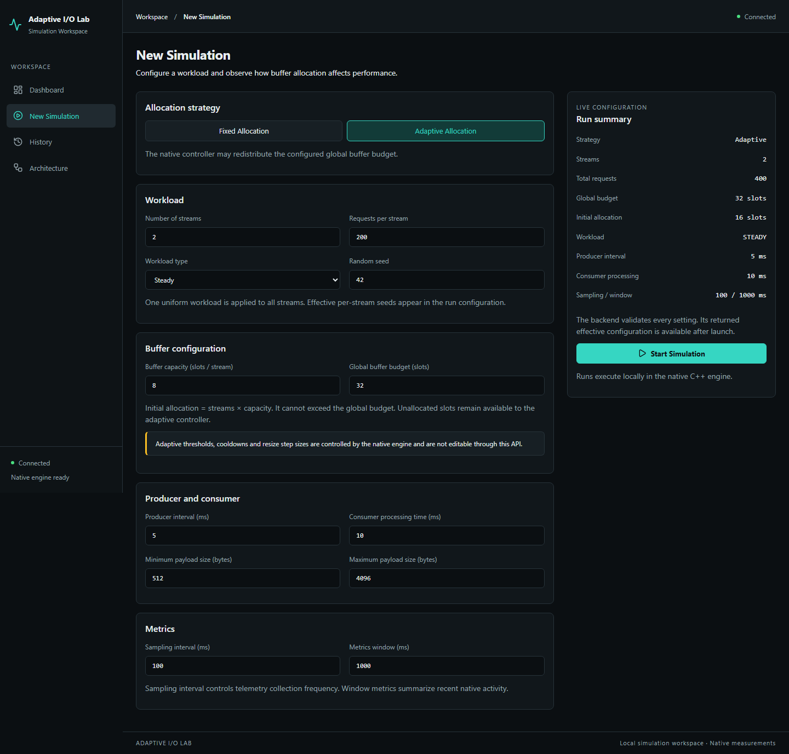

# Adaptive I/O Buffer Simulator

Adaptive I/O Buffer Simulator is a local academic project for exploring how buffer allocation affects concurrent producer–consumer workloads. Its C++ engine runs configurable I/O simulations, and its browser workspace, Adaptive I/O Lab, shows how queue occupancy, allocated capacity, and performance change during a run.

## Problem statement

A fixed-size queue can leave slots unused when traffic is light and force producers to wait when traffic bursts. Giving every stream more space consumes a shared resource and can allow more requests to wait in the queue. Adaptive allocation lets the controller grow or shrink individual buffers within a global slot budget. The simulator makes these trade-offs observable across workloads, stream counts, and allocation strategies.

## Objectives

- Run fixed and adaptive allocations against configurable workloads.
- Observe per-stream buffer occupancy and capacity alongside throughput, latency, and producer waiting.
- Relate native resize attempts to the measurements that triggered them and see which capacities actually changed.
- Compare retained runs to explore how workload and allocation settings affect a shared buffer budget.

## Key features

- **Configurable simulations.** Choose fixed or adaptive allocation, a workload pattern, a random seed, stream and request counts, producer and consumer timing, and a global buffer budget.
- **Live run inspection.** View sampled occupancy and capacity per stream, charts for throughput and producer waiting, the effective configuration, run state, and final results when available.
- **Adaptive decision timeline.** Inspect engine-reported resize outcomes and reasons, including deferred attempts. Entries show previous, requested, and actual capacities where reported. Chart markers link to timeline entries when the triggering sample is available.
- **History and comparison.** Find recent runs, compare available metrics side by side, and use a retained effective configuration as the starting point for a new simulation.
- **JSON and CSV exports.** Download retained run observations and comparison data from the browser.
- **Native execution and resource limits.** The C++17 engine runs bounded queues under a shared slot budget. The Express bridge validates input, caps concurrent runs, and handles cancellation and timeouts.

## Technology stack

| Layer | Technologies |
| --- | --- |
| Browser workspace | React 19.3.1, React Router 7.18.5, TypeScript 5.9.3, Vite 7.3.7, Recharts 3.10.1, Lucide React 0.548.0, and CSS |
| HTTP bridge | Node.js 24 and Express 5.3.0 |
| Simulation engine | C++17, standard threads and synchronization primitives |
| Native build | CMake 3.15 or newer. The Windows setup below uses Ninja. |
| Testing | CTest and native C++ test executables, Node's built-in test runner, Vitest 5.0.5, React Testing Library 16.3.3, and Playwright 1.64.1 |

The JavaScript package versions are pinned by the npm lockfiles.

## System architecture



## How it works

1. The browser submits an allocation strategy, a workload, buffer settings, and a telemetry interval.
2. Express validates the settings and checks admission limits before launching the native executable as a child process.
3. The engine runs producer and consumer threads against bounded queues. In adaptive mode, the controller evaluates native metrics and can request capacity changes within the shared budget.
4. The bridge reads the engine's telemetry and final result from standard output. The browser polls the API for run status and retained observations.
5. Run Details connects measured samples to emitted resize attempts. History provides configuration reuse, comparisons, and exports.

## Project structure

```text
.
├── CMakeLists.txt   Native build targets and CTest registration
├── client/          React workspace, unit tests, and browser tests
├── configs/         Native workload and experiment configurations
├── docs/assets/     Application screenshots
├── engine/          C++ engine, command-line tools, and native tests
├── scripts/         Experiment analysis and verification utilities
├── server/          Express bridge and backend tests
└── tests/           Native stress test
```

## Installation and setup

These commands use PowerShell on Windows. Install Git, Node.js 24 with npm, CMake 3.15 or newer, Ninja, and a C++17 compiler. Put Ninja and the compiler on `PATH`, or open a developer shell that configures the compiler. The Windows toolchain used for verification was MinGW GCC 15.2, CMake 4.4.4, and Ninja 1.13.2. Python 3 is optional and enables the Python checks registered with CTest.

Clone the repository and build the engine from the repository root.

```powershell
git clone https://github.com/Omkar-791/Adaptive-I-O-Buffer-Simulator.git
cd Adaptive-I-O-Buffer-Simulator
cmake -S . -B build -G Ninja -DCMAKE_BUILD_TYPE=Release
cmake --build build
```

Start the bridge in the first terminal. It listens on `127.0.0.1:3000` by default.

```powershell
cd server
npm.cmd ci
$env:NATIVE_EXECUTABLE = (Resolve-Path '../build/adaptive_io_sim.exe').Path
npm.cmd start
```

Open a second terminal in the repository root and start the browser workspace.

```powershell
cd client
npm.cmd ci
npm.cmd run dev
```

Open the workspace and check that it reports the native engine is ready. The Vite proxy forwards API requests to port 3000. [Adaptive I/O Lab](http://127.0.0.1:5173) · [Bridge health endpoint](http://127.0.0.1:3000/api/v1/health)

### Tests and checks

Run the following from the repository root after building the native targets and installing both packages' dependencies.

```powershell
Push-Location build
ctest --output-on-failure
Pop-Location

Push-Location server
$env:NATIVE_TEST_EXECUTABLE = (Resolve-Path '../build/adaptive_io_sim.exe').Path
npm.cmd test
Pop-Location

Push-Location client
npm.cmd run lint
npm.cmd run typecheck
npm.cmd test
npm.cmd run build
Pop-Location
```

For browser tests, keep both services running on the default ports and run `npm.cmd run test:e2e` from `client/`. Playwright defaults to the installed Microsoft Edge on Windows. The `PLAYWRIGHT_CHANNEL` environment variable selects a different installed browser channel if needed.

## Usage guide

1. Open **New Simulation** and choose **Fixed Allocation**. Set the workload, number of streams, initial capacity per stream, and global budget. The budget must cover the initial allocation across all streams.
2. Select **Start Simulation**. In **Run Details**, monitor the run state, measured throughput and producer waiting, and each stream's occupied and allocated slots. The **Result** tab shows the final summary after successful completion.
3. Select **Reuse configuration** and run the same settings with **Adaptive Allocation**. Check the timeline for resize attempts and select a chart marker to reveal its corresponding event.
4. Open **History** to find retained runs and select runs for comparison. Compare throughput, mean latency, and other metrics alongside the effective configurations.
5. Use the JSON or CSV export controls to download available run observations or comparison data before older runs are evicted.

## Screenshots

### Adaptive run inspection



### Simulation setup



## Limitations

- The engine simulates I/O workloads. Results depend on the selected settings and host scheduling, so browser comparisons are descriptive.
- Run history lives in bounded backend memory. Restarting the backend clears it, and retention limits can remove older runs or telemetry.
- Live charts show sampled or windowed measurements. Resize markers use the elapsed time of the triggering native sample. The engine does not emit an exact timestamp for each resize attempt.
- The browser applies a uniform workload configuration across streams and exposes allocation strategy and budget. Adaptive thresholds, cooldowns, and resize step sizes are controlled by the engine.

## Future scope

- Persist run history and support reimporting exported results.
- Expose per-stream workload settings in the browser.
- Add repeatable multi-run comparisons with variability estimates.

## License

No license is currently specified.

## Author

Omkar. [GitHub profile](https://github.com/Omkar-791)
