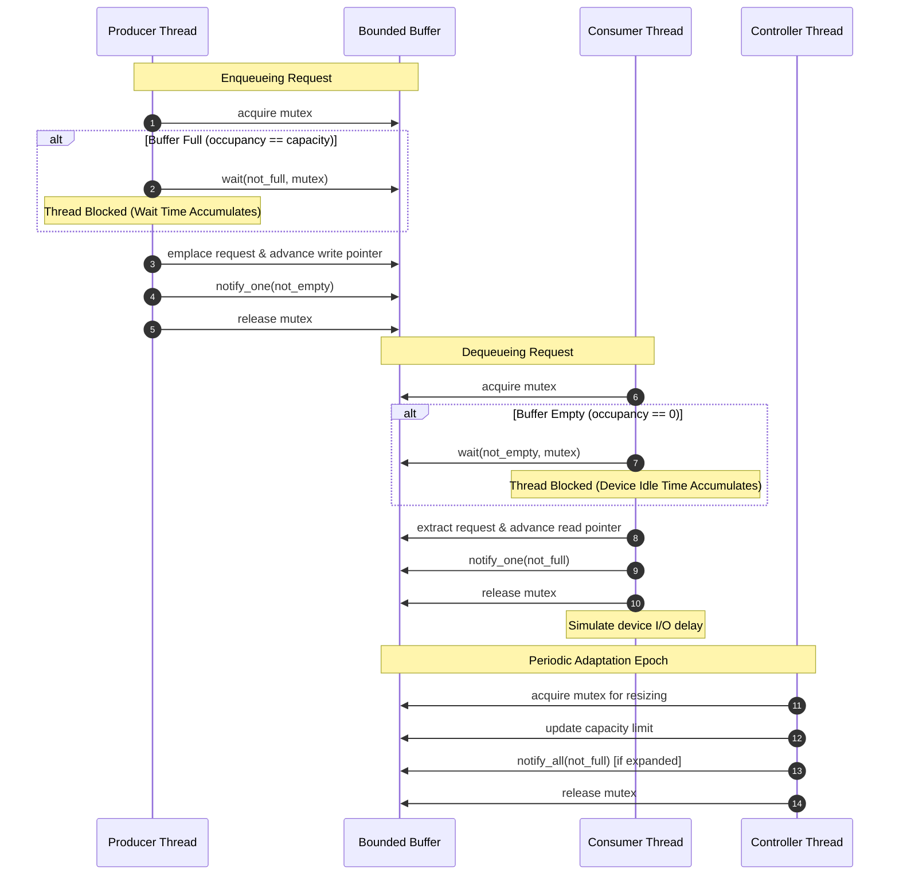
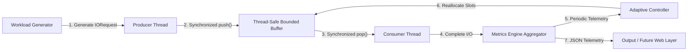
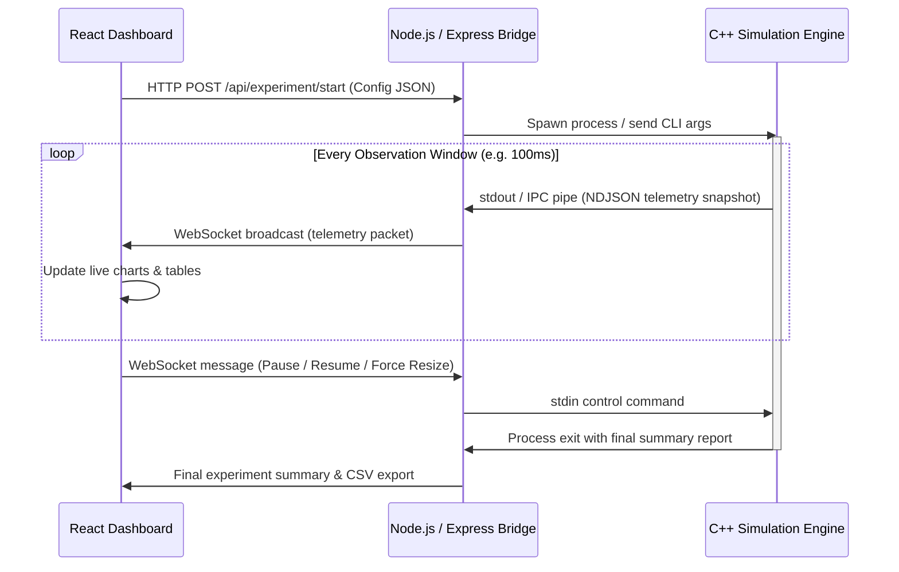

# System Architecture

## 1. High-Level Architecture Overview

The **Adaptive I/O Buffer Management System** is designed with a strictly decoupled multi-tier architecture. The computational core is an operating systems simulation engine implemented in native C++. The future presentation and telemetry layer consists of a lightweight Node.js/Express IPC bridge and a React-based interactive web dashboard.

```mermaid
graph TD
    subgraph UI ["Future Visualization Layer (Browser)"]
        RD["React Dashboard (Vite + Tailwind + Recharts)"]
    end

    subgraph Server ["Future Server Bridge (Node.js)"]
        WS["WebSocket Server"]
        REST["REST API"]
        IPC["Subprocess IPC Manager"]
        WS --- IPC
        REST --- IPC
    end

    subgraph Engine ["Simulation Core (C++ Native Engine)"]
        WG["Workload Generator"]
        BM["Buffer Manager (Global Budget)"]
        AC["Adaptive Controller"]
        ME["Metrics Engine"]

        subgraph Streams ["Concurrent I/O Streams (1..N)"]
            subgraph Stream1 ["Stream 1"]
                P1["Producer Thread 1"] --> B1["Bounded Buffer 1"] --> C1["Consumer Thread 1"]
            end
            subgraph Stream2 ["Stream 2"]
                P2["Producer Thread 2"] --> B2["Bounded Buffer 2"] --> C2["Consumer Thread 2"]
            end
            subgraph StreamN ["Stream N"]
                PN["Producer Thread N"] --> BN["Bounded Buffer N"] --> CN["Consumer Thread N"]
            end
        end

        WG -. Ingest Requests .-> P1
        WG -. Ingest Requests .-> P2
        WG -. Ingest Requests .-> PN

        BM --- B1
        BM --- B2
        BM --- BN

        B1 -. Telemetry .-> ME
        B2 -. Telemetry .-> ME
        BN -. Telemetry .-> ME

        ME -. Window Metrics .-> AC
        AC -. Resize Commands .-> BM
    end

    RD <==>|WebSocket Telemetry & Control| WS
    IPC <==>|Stdio / Socket Stream (JSON)| Engine
```

---

## 2. Phase 1 & 2 Architecture (Implemented)

The system currently provides a fully concurrent, modular multi-stream simulation core:

```
                         Simulation
                             │
                      Stream Manager
                             │
            ┌────────────────┼────────────────┐
            ▼                ▼                ▼
        IOStream 0       IOStream 1       IOStream N-1
            │                │                │
       ┌────┴────┐      ┌────┴────┐      ┌────┴────┐
       │         │      │         │      │         │
   Producer   Buffer  Producer   Buffer  Producer   Buffer
       │         │      │         │      │         │
       │         ▼      │         ▼      │         ▼
       │      Consumer  │      Consumer  │      Consumer
       │                │                │
       └────────────────┼────────────────┘
                        │
                     Metrics
            (Per-Stream & Global Aggregates)
```

### Implemented Components (Phase 1, 2, 3, and 4)
- **`Request`**: Models an I/O request with unique ID, payload bytes, stream ID, and precise lifecycle timestamps (`creation_time`, `enqueue_time`, `dequeue_time`, `completion_time`).
- **`BoundedBuffer`**: Thread-safe circular queue holding `Request` items with hard capacity, mutex, condition variables (`not_full_`, `not_empty_`), and safe shutdown semantics.
- **`WorkloadGenerator` (Phase 4)**: Dedicated synthetic traffic generation subsystem supporting 5 patterns (`STEADY`, `BURST`, `PERIODIC`, `STOCHASTIC`, `MIXED`). Operates as a pure decision engine (`WorkloadRequest`) decoupled from thread sleeping, with deterministic PRNG (`std::mt19937`).
- **`ConfigParser` (Phase 4)**: Lightweight JSON parser for loading simulation parameters and uniform/heterogeneous multi-stream workload configurations from files (`configs/*.json`) or in-memory strings.
- **`Producer`**: Dedicated worker thread querying `WorkloadGenerator` for requests and arrival intervals, sleeping for the requested inter-arrival time, pushing to `BoundedBuffer`, and measuring queue blocking time.
- **`Consumer`**: Dedicated worker thread popping requests, simulating hardware device processing latency, and recording turnaround latency.
- **`IOStream`**: Encapsulates one complete concurrent channel: owns a `Producer`, a `BoundedBuffer`, a `Consumer`, and manages their two dedicated threads.
- **`StreamManager`**: Orchestrates $N$ independent `IOStream` instances ($2N$ concurrent threads), providing synchronized execution and deadlock-free multi-stage shutdown.
- **`BufferResourceManager` (Phase 3)**: Manages the global shared buffer budget $B_{\text{total}}$, validates that $\sum C_i \le B_{\text{total}}$ and $C_i \ge C_{\text{min}}$, implements deterministic equal and remainder allocation, and establishes thread-safe interfaces for Phase 6 dynamic resizing.
- **`Metrics` (`StreamMetrics`, `SimulationMetrics`)**: Aggregates throughput, average/min/max latencies, producer wait times, time-weighted buffer occupancy, workload types, and global buffer budget allocations per stream and across the entire system.
- **`Simulation`**: Top-level orchestrator interfacing with CLI and configuring `StreamManager` under `BufferResourceManager` constraints.
- **Data & Event Models (`DataModels.h`, `EventModel.h`, `ErrorCodes.h`)**: Canonical structures mapping directly to JSON for headless backend IPC and telemetry streaming. Detailed contract in `docs/INTEGRATION_CONTRACT.md`.

### Concurrency & Synchronization Invariants
1. **Per-Stream Isolation**: Each stream operates with its own independent `BoundedBuffer`, `std::mutex`, and condition variables (`not_full_`, `not_empty_`). There is zero lock contention between different streams during ordinary I/O processing.
2. **Buffer Mutual Exclusion**: Buffer state (`count_`, `head_`, `tail_`, `ring_buffer_`, and `closed_`) is strictly protected by `mutex_`. No thread may read or mutate buffer state without holding `std::unique_lock<std::mutex>`.
3. **No Busy Waiting**: Producer threads block on `not_full_.wait()` when `count_ == capacity_`; consumer threads block on `not_empty_.wait()` when `count_ == 0`.
4. **Spurious Wakeup Protection**: All condition variable waits are guarded by explicit predicate while loops.
5. **Synchronized Three-Stage Shutdown Protocol**:
   - **Stage 1 (Producers Complete)**: `StreamManager::joinAll()` joins all $N$ producer threads, guaranteeing all target requests are submitted.
   - **Stage 2 (Buffers Close)**: Calls `close()` on all $N$ stream buffers. Any waiting producers are released; any waiting consumers on empty buffers are signaled that no more items will arrive.
   - **Stage 3 (Consumers Drain & Join)**: Joins all $N$ consumer threads, ensuring all enqueued items are drained and processed without data loss or leaks.

---

## 3. Planned Engine Architecture (Future Phases)

The C++ simulation engine is the core deliverable of this OS course project. It models operating system buffer cache management and I/O request queuing under concurrent execution.

### Key Components

1. **Workload Generator (`WorkloadGenerator`)**
   - Synthesizes I/O requests based on deterministic mathematical models (Poisson arrivals, uniform burst distributions, step ramps).
   - Generates request payloads containing metadata: `requestId`, `streamId`, `timestampCreated`, `dataSize`, and `priority`.
   - Driven by pseudo-random number generators with configurable seeds (`std::mt19937`).

2. **I/O Stream Model (`IOStream`)**
   - Encapsulates an end-to-end I/O channel representing a virtual disk device, network socket, or IPC pipe.
   - Pairs a dedicated **Producer Thread** (representing an application process generating write requests) with a dedicated **Consumer Thread** (representing a storage controller or network interface draining requests).
   - Hosts a dynamic **Bounded Circular Buffer**.

3. **Bounded Buffer (`BoundedBuffer`)**
   - Thread-safe circular queue holding `IORequest` objects.
   - Synchronization primitives:
     - `std::mutex`: Protects queue state, read/write pointers, and capacity counters.
     - `std::condition_variable not_full`: Blocks producers when buffer is at capacity.
     - `std::condition_variable not_empty`: Blocks consumers when buffer is empty.
   - Dynamic Resizing Capability: Supports runtime capacity expansion or contraction without losing enqueued items or violating FIFO ordering.

4. **Global Buffer Manager (`BufferManager`)**
   - Enforces the global memory budget: $\sum_{i=1}^N \text{Capacity}_i \le B_{\text{total}}$.
   - Maintains an unallocated free pool: $B_{\text{free}} = B_{\text{total}} - \sum \text{Capacity}_i$.
   - Coordinates multi-buffer capacity adjustments using strict lock acquisition ordering to avoid deadlocks.

5. **Metrics Engine (`MetricsEngine`)**
   - Periodically polls stream states or receives fine-grained event hooks.
   - Computes statistical metrics per stream and globally over discrete observation intervals $\Delta t$.
   - Tracks occupancy, utilization, throughput, latency, producer blocked time, and consumer idle time.

6. **Adaptive Controller (`AdaptiveController`)**
   - Implements closed-loop feedback control.
   - Reads aggregated telemetry from the `MetricsEngine` at each observation epoch.
   - Evaluates multi-signal congestion indicators (occupancy trends, producer blocking rates).
   - Makes explainable reallocation decisions, adjusting stream capacities within the global budget.

---

## 3. Thread & Concurrency Model

The engine adopts a clear, isolated thread-per-role design:

- **Producer Threads ($N$ threads)**: Simulates workloads issuing I/O requests. Calls `buffer.push(request)`. Blocks on `not_full` condition variable if buffer capacity is saturated.
- **Consumer Threads ($N$ threads)**: Simulates storage/network devices draining requests. Calls `buffer.pop()`. Blocks on `not_empty` condition variable if buffer is empty. Emulates device latency via high-resolution timers.
- **Controller / Monitor Thread (1 thread)**: Periodic daemon waking up every $\Delta t$ milliseconds to aggregate metrics, run the adaptation policy, and trigger buffer reallocations.



---

## 4. Data Flow Pipeline

The flow of an I/O request from synthesis to metrics aggregation proceeds linearly:



---

## 5. Future Web & Telemetry Integration Architecture

To ensure the C++ simulation core remains fully independent, the future web dashboard interacts strictly via a standardized Inter-Process Communication (IPC) protocol:



### Architectural Principles Applied
- **Strict Decoupling**: The C++ engine has zero dependencies on Node.js, npm, or web frameworks. It runs autonomously from the command line.
- **Fail-Safe IPC**: Standard JSON over stdout or Unix domain sockets / named pipes prevents foreign binary coupling.
- **Independent Repeatability**: Experiments can be configured and run entirely via headless CLI scripts for statistical rigor without rendering the UI.

## Phase 5 implemented path

Simulation starts MetricsEngine before workers, drains workers, then joins the sampler and captures a final snapshot. BoundedBuffer::observe() supplies synchronized cumulative records. A bounded deque derives window rates, occupancy and waits; fixed histograms supply quantized percentiles. latest() and Simulation::latestMetrics() expose copied controller observations. See [definitions](METRICS_PHASE5.md).

## Phase 6 implemented decision path

`MetricsSnapshot -> AdaptiveController::evaluate -> AllocationDecision`. The policy is a separate single-coordinator component with bounded per-stream state. It consumes current allocations and bounds, with a read-only resource-manager adapter, and returns sorted recommendations and explanations. No accounting mutation or queue resizing is performed. Existing serialized Simulation metrics callbacks are the embedding point. See [policy definitions](CONTROLLER_PHASE6.md). The earlier full feedback diagrams describe the future runtime-integrated design.

## Phase 7 runtime implementation

Opt-in Simulation::enableAdaptive links the existing sampler to the independent controller and RuntimeResizeExecutor. The executor binds exact stream queues to resource accounting, stages replacement storage, and uses resource -> sorted queue try-locks to validate live state and commit FIFO rings and accounting together. No new thread is introduced. Busy or unsafe shrink plans defer as a whole. Capacity-time integrals preserve utilization definitions under changing limits. See [runtime lifecycle and locks](RUNTIME_RESIZING_PHASE7.md); earlier fixed-capacity notes are historical phase descriptions.

## Phase 8 experiment path

ExperimentRunner normalizes source configuration and seeds once per run, computes capped equal initial allocations for either strategy, and invokes a fresh existing Simulation. Fixed runs never enable adaptation; adaptive runs use the unchanged Phase6/7 loop. Actual producers checksum nominal generated decisions; the runner verifies them against preflight and exports cumulative whole-run measurements. A separate CLI performs one run and a Python-standard-library driver counterbalances paired repetitions and saves manifest/JSONL/descriptive statistics. See [methodology](EXPERIMENTS_PHASE8.md) and [measured report](PHASE8_EXPERIMENTAL_REPORT.md).

## Phase 9 workflow and recovery

The unchanged native experiment runner is orchestrated by a deterministic expanded Python plan. Each run has plan/config/pair/run identities and provenance hashes. Immutable atomic attempt envelopes are authoritative; JSONL/statistics/CSV/JSON/Markdown are regenerated views. A persistent native writer lock prevents concurrent recovery, and strict result validation gates skipping. Pre/post execution hashes detect source/executable/workflow drift. Shared atomic I/O has bounded Windows sharing-error retries. Controlled profiles use existing rate fields; controller and runtime queue algorithms remain unchanged. See [workflow contract](EXPERIMENTS_PHASE9.md) and [actual evaluation](PHASE9_EXPERIMENTAL_REPORT.md).

## Phase 10 implemented backend bridge

The loopback Express API accepts a bounded validated simulation configuration, normalizes explicit heterogeneous streams, and delegates to RunManager. A trusted executable is spawned with argv, shell:false, controlled cwd and a runtime environment whitelist. Per-run private config files are removed after confirmed close. Incremental UTF8/NDJSON validation retains bounded snapshots/resize events and stores the successful final result separately. Admission, timeout, termination and shutdown preserve explicit states and active slots until closure/cleanup. No frontend, database, WebSocket or new native algorithm is introduced. See [API/lifecycle/security limits](BACKEND_PHASE10.md).

## Phase 11 frontend: Adaptive I/O Lab

The React/Vite strict TypeScript client under client/ adds a shared dark observability shell and Dashboard, New Simulation, Run Details, History and Architecture routes. Approved low-fidelity SVG layouts live in design/wireframes/. Custom CSS tokens established by the original Phase11 specification are retained under the revised prompt's compatible-frontend rule.

The browser sends supported configurations through a centralized typed fetch client. The Express bridge remains authoritative for validation, run state, process termination, telemetry retention and successful result availability. No native/controller/runtime algorithm or Phase10 API changes are required. Vite's loopback same-origin proxy preserves Host/Origin semantics; VITE_API_BASE_URL supports a configured alternative.

useRun owns one sequential status/telemetry loop, abort cleanup, cursor commit, index deduplication, bounded600-record browser retention, retry/backoff, terminal draining and result retrieval. Native elapsed times drive chart axes; backend receivedAt is used only as receipt-time metadata. Capacity uses measured step changes. Historical charts can be incomplete because backend retention is bounded; the UI discloses truncation. History remains in memory, and per-stream worker status is not available in the protocol.

The full configuration/result views display the actual returned objects. The form supports uniform streams with all five workload types, including explicit explained MIXED phases. Controller tuning, persistent history and WebSocket transport remain separate milestones. Phase13 adds descriptive matched-pair comparison as documented below. See ../client/README.md and PHASE11_COMPLETION_REPORT.md for actual verification and limits.

## Phase 13 analysis integration

History embeds ComparisonView rather than adding another page or state framework.
A source effective configuration is submitted twice through the centralized typed API,
changing strategy only. Independent admission is explicit: partial success retains the
first process ID and its cancellation/status controls. Two existing useRun instances
own distinct members' polling, cursor/retention, terminal result and cleanup; duplicate
URL IDs cannot create duplicate polling. Navigation aborts observation, not native work.

analysis.ts canonicalizes effective config/sampling, verifies final counts/bytes and
provides exact metric rows plus self-describing JSON/CSV. Three separate-unit bar charts
render native whole-run measurements. RunStrip and AllocationEvents preserve authoritative
lifecycle/capacity/reason/timing semantics. Exports carry requested IDs, errors and loss
flags even for unavailable members. Blob URLs are revoked after downloads.

No backend/native API or process algorithm changes. Registry/telemetry remain bounded
and ephemeral. Concurrent comparisons are descriptive; Phase8/9 CLI artifacts retain
the stronger provenance/checksum/counterbalancing contract. See PHASE13_API_CONTRACT.md.
