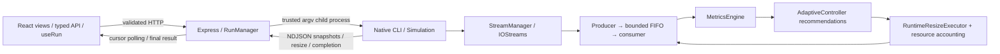
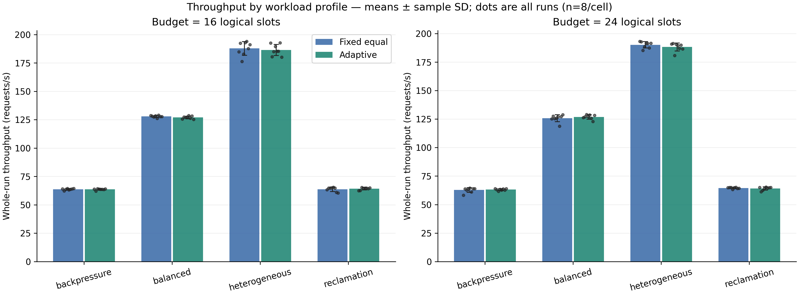
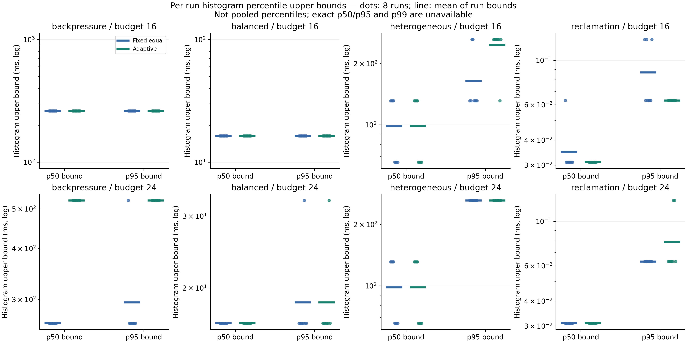
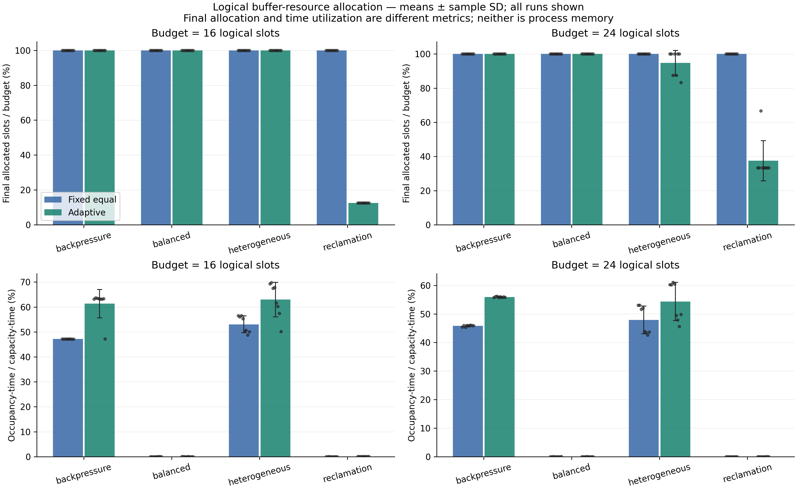

# Adaptive I/O Buffer Management and Performance Optimization System

## Project details and abstract

Operating Systems course project; implementation C++17, Python experiment tooling,
Node/Express bridge and React/Vite/TypeScript observability. Prepared2 November2026.
Authorship/institution details are not inferred from repository paths or account names.

This project studies bounded producer-consumer queues sharing a logical slot budget.
It combines deterministic workload generation, synchronized queues, resource accounting,
telemetry, an explainable adaptive policy and transactional physical resizing. A connected
browser/Express/native workflow makes real execution observable. Evaluation uses128
tracked controlled runs/64 matched pairs. Adaptive allocation measurably reclaims idle
capacity and reduces producer waiting in pressure cases, but can increase completion
latency without improving throughput. Results are descriptive and workload-specific.
A separately verified hour-long adaptive stress run supports lifecycle/resource safety
for the exercised workload, not universal performance superiority.

## 1. Motivation, problem and objectives

A small queue applies backpressure to producers; a large queue reserves scarce slots
and may increase queue residence. Fixed allocation cannot respond to shifting demand.
The problem is to redistribute bounded queue capacity across concurrent streams without
losing FIFO order, exceeding the global budget or confusing a recommendation with a
physical change. Objectives are correct concurrency, explainable bounded adaptation,
truthful measurements, reproducible comparison and a demonstrable connected system.

The simulator models OS concepts, not real disk hardware or a production page cache.
Requests carry IDs, payload-byte metadata and lifecycle timestamps. Consumer service
uses configured per-request sleeping; payload size does not determine service duration.
No real disk/network device latency or process-memory benchmark is implied.

## 2. OS concepts and actual architecture

The design demonstrates producer-consumer synchronization, bounded buffering,
condition-variable blocking, mutual exclusion, resource allocation, feedback control,
backpressure, thread lifecycle management and inter-process communication.



| Component | Responsibility and implementation |
|---|---|
| BoundedBuffer | Per-queue mutex/condition variables, FIFO, close/drain and synchronized observations; engine/src/BoundedBuffer.cpp |
| Producer / Consumer / IOStream | Two workers per stream, generation/backpressure and service/completion; engine/src/Producer.cpp, Consumer.cpp, IOStream.cpp |
| StreamManager / Simulation | Configure topology; join producers, close queues, drain/join consumers; engine/src/StreamManager.cpp, Simulation.cpp |
| BufferResourceManager | Logical slot budget, allocations, bounds; engine/src/BufferResourceManager.cpp |
| MetricsEngine | Baseline/periodic/final observations, bounded window and fixed histograms; engine/src/MetricsEngine.cpp |
| AdaptiveController | Serialized stateful recommendations; engine/src/AdaptiveController.cpp |
| RuntimeResizeExecutor | Staged FIFO-preserving queue replacement and accounting commit; engine/src/RuntimeResizeExecutor.cpp |
| Express bridge | Validate JSON, shell:false trusted executable spawning, bounded NDJSON, lifecycle/results, sanitized errors; server/src/ |
| React client | Actual state/telemetry, configuration, details, history, matched comparison/export; client/src/ |

Native code has no Node or React dependency. HTTP cannot choose arbitrary executable
paths. The backend owns starting/running/completed/failed/cancelled/timed_out state;
completion requires valid native result and successful process close. Cancellation is
process termination, not graceful native control. Native elapsed time is distinct from
backend receipt timestamps and frontend display state. History is bounded/in memory.
The client uses one sequential cursor-polling loop per selected run, abort cleanup,
deduplication, bounded retention, terminal draining and explicit truncation warnings.

## 3. Buffer, budget and resizing model

For stream i, queued occupancy Q_i and capacity C_i satisfy0 ≤ Q_i ≤ C_i, C_i ≥1 and
sum_i C_i ≤ B. Occupancy excludes the request being serviced. The budget constrains
logical active request slots, not payload bytes, process RSS or staging heap storage.
A resize can temporarily allocate replacement storage beyond the logical active budget.

The experiment fixed_equal baseline computes a capped equal water level within per-stream
limits (1..64 in the measured corpus), with deterministic sorted-ID remainders. Adaptive
starts from the same allocation and enables the existing controller/executor. The web
API's fixed strategy instead preserves explicitly configured capacities; these strategy
names are not interchangeable without checking effective inputs.

For each stream, controller signals are window utilization U, producer ratio P=producer
wait_ms/window_ms, consumer ratio Q=consumer wait_ms/window_ms, and throughput R. High
pressure requires U≥80% and P≥0.05. Low demand requires U≤30%, P≤0.01 and either Q≥0.05
or R=0. Three accepted non-overlapping confirming windows,100ms update spacing,500ms
cooldown and4-slot steps are the Phase9 defaults. Donors release only safe capacity above
minimum/current occupancy; eligible receivers share slack with capped fair grants and
rotating remainder priority. No growth is promised to improve a fixed-rate consumer.

RuntimeResizeExecutor stages replacement rings, then uses resource-manager and sorted
queue try-locks to revalidate live state. Safe plans commit physical capacity and resource
accounting together; unsafe/stale/busy plans defer or reject explicitly. Growth wakes
producers after unlocking. FIFO order is preserved. A recommendation alone is not a resize.

## 4. Workloads and experimental design

WorkloadGenerator uses mt19937 and separates nominal decisions from thread execution.
STEADY uses a constant interval. BURST switches by request index between normal/burst
lengths and intervals. PERIODIC uses an explicit interval sequence or rounded,
nonnegative base*(1+amplitude/100*sin(2*pi*(index mod period)/period)). STOCHASTIC samples
an exponential interval with configured lambda or1/base_interval, clamps to0..1000ms,
and rounds; base0 with no positive lambda yields0. MIXED cycles through named phases
with explicit request counts/intervals/payload bounds. Payloads are uniformly selected
within bounds. Standard-library distributions need not match across toolchains.

A producer sleeps its nominal interval after the previous push. Thus full-queue waiting
shifts actual arrival times: this is a closed-loop sleep-based workload, not an externally
paced open-loop device trace. Matching nominal seeds does not force matching wall clocks.

Primary source: [Phase9 raw runs](../data/experiments/phase9_controlled/runs.jsonl),
[plan](../data/experiments/phase9_controlled/plan.json) and
[methodology](EXPERIMENTS_PHASE9.md). Four profiles × two budgets(16/24) × two seeds(42/101)
× four repetitions × two strategies =128 runs,64 pairs, eight observations/strategy/cell.
The128 runs are all successful; no run was excluded. Active streams have80 requests,
64..1024-byte workload payloads; idle donors retain zero requests. Sampling20ms/window100ms,
limits1..64 and controller defaults match across strategies.

Profiles: reclamation(8ms steady arrival,0ms service plus idle donor); backpressure(0ms
arrival,5ms service plus donor); balanced(two2ms arrival/2ms service streams); heterogeneous
(burst8→0ms/service3ms, periodic10ms/service0ms, stochastic mean2ms/service3ms).
These nominal intervals are not claims about achieved rates on Windows timers.

Pairs match full effective configs, seeds/repetition, limits, sampling/controller settings,
initial allocations and native nominal-input fingerprints. Actual producer checksums are
verified against preflight in ExperimentRunner. Sequential strategy order alternates by
paired block. Attempts, failures and provenance are preserved by the existing workflow;
resumed execution can separate pair members in time. No warmup trimming, CPU affinity,
timer-resolution tuning or significance test is applied. Sample SD mixes seed and scheduling
variation; n=8 is not eight independent hardware environments.

Phase8's30 earlier runs cover five workload types with one seed/three repeats; pressure
relief was not demonstrated in that corpus. Phase13's live matched pairs may overlap,
lack CLI checksum/executable provenance and are descriptive integration evidence. Phase14
burst and hour runs are safety/stress diagnostics, not matched strategy comparisons.

## 5. Mathematical metric definitions

Definitions follow MetricsEngine, IOStream, StreamManager and ExperimentRunner source.
Let N be completed requests, D actual elapsed seconds, b_j completed payload bytes and
l_j creation-to-completion latency. Whole-run throughput=N/D requests/s; byte throughput
=sum b_j/(D*1024^2) MiB/s (legacy field name uses MB). Mean latency=sum l_j/N; the global
mean is completion-weighted. It includes producer blocked time, queue residence and
service. Empty windows return zero, not a fabricated percentile observation.

Each queue observation is mutex-consistent; streams are sampled sequentially, so a global
sample is not an atomic cross-stream transaction.

Window throughput=(N(t)-N(t0))/(t-t0), using observed sampled elapsed time rather than the
requested interval. Producer waiting sums actual full-queue blocking intervals, including
ongoing waits in snapshots. Consumer waiting measures empty-queue blocking and includes
lifecycle idle time. Sums across workers may exceed wall duration.

Average occupancy=sum_i integral Q_i(t)dt / D in slot units. Time utilization is
100*sum_i integral Q_i(t)dt / sum_i integral C_i(t)dt; capacity-time handles resizing.
Final allocated-budget fraction=100*sum_i C_i(final)/B is a separate derived endpoint
measure. A lower fraction means more logical slack at completion, not lower RSS, energy
use or proven performance efficiency. Exact global peak utilization is unavailable.

The fixed64-bucket latency histogram retains whole-run counts. Bucket k spans
[2^k-1,2^(k+1)-1) microseconds (last saturates). For q, select the first cumulative bucket
count≥ceil(q*N); report (2^(k+1)-1)/1000ms. Plotted p50/p95 are these upper boundaries.
Exact raw request percentiles and p99 are unavailable in the retained corpus. The plots
show every run's bound and its arithmetic mean, not a pooled request percentile and not
percentiles inferred from mean latency.

Descriptive mean= sum x_j/n and sample SD=sqrt(sum(x_j-mean)^2/(n-1)). Tables/plots group
by effective workload and budget. Relative change=100*(adaptive_mean-fixed_mean)/fixed_mean;
zero fixed baselines have unavailable percentages. Paired differences require matched
pair IDs; the table below uses differences between strategy means, not a significance test.

## 6. Experimental setup and numerical results

Recorded Phase9 environment:Windows11 build26200,AMD64,Python3.14.3, GCC15.2.0,C++17,-O2
with warnings. Machine model, CPU pinning and physical device performance were not recorded
as controlled experimental variables. Do not infer hardware specifications from paths.
The native binary/source/config/workflow provenance is retained in the historical manifest.

All values below are whole-run means ± sample SD; n=8 per strategy/cell. Producer wait
change is a difference of means. Complete figure data contains all other metric summaries.

| Profile | Budget (slots) | Fixed req/s | Adaptive req/s | Fixed mean latency (ms) | Adaptive mean latency (ms) | Wait change (%) |
|---|---:|---:|---:|---:|---:|---:|
| backpressure | 16 | 63.682 ± 0.700 | 63.614 ± 0.684 | 148.127 ± 1.585 | 183.237 ± 14.656 | -4.772 |
| backpressure | 24 | 62.777 ± 2.134 | 63.133 ± 0.837 | 204.534 ± 6.745 | 240.937 ± 3.804 | -5.973 |
| balanced | 16 | 127.891 ± 0.859 | 126.955 ± 1.214 | 15.633 ± 0.104 | 15.748 ± 0.151 | Unavailable (zero baseline) |
| balanced | 24 | 125.763 ± 3.063 | 126.901 ± 1.958 | 15.904 ± 0.398 | 15.759 ± 0.244 | Unavailable (zero baseline) |
| heterogeneous | 16 | 187.789 ± 6.101 | 186.398 ± 4.886 | 58.853 ± 4.644 | 64.684 ± 7.363 | -6.599 |
| heterogeneous | 24 | 190.187 ± 2.804 | 188.315 ± 3.518 | 73.616 ± 6.513 | 76.016 ± 9.975 | -3.146 |
| reclamation | 16 | 63.675 ± 1.928 | 64.230 ± 1.072 | 0.038 ± 0.006 | 0.032 ± 0.003 | Unavailable (zero baseline) |
| reclamation | 24 | 64.568 ± 0.647 | 64.095 ± 1.437 | 0.033 ± 0.004 | 0.033 ± 0.006 | Unavailable (zero baseline) |

### Throughput versus workload



Profile categories are the independent variable; there is no invented continuous intensity
axis. Budgets are separated. Dots show all runs, bars show means, whiskers sample SD—not
confidence intervals. Throughput changes are small and mixed. Balanced runs performed
no resizes, so their differences cannot be attributed to physical capacity changes.

### Latency percentile bounds



Each workload/budget panel has its own logarithmic vertical scale. Compare fixed/adaptive
within a panel; do not compare pixel heights across panels. Bound quantization can make
p50 and p95 equal and hide smaller true differences. Mean latency can increase even where
reported histogram bounds are unchanged. No exact-percentile or p99 claim is supported.

### Logical allocation and utilization



Reclamation at budget16 ended at two total slots instead of16 in all eight adaptive runs
(12.5% final allocation;87.5% logical budget slack). At budget24 most ended at eight total
slots, with one16-slot outcome. All outcomes remain visible. Heterogeneous budget24 has
variable final allocation. Utilization is occupancy-time/capacity-time and must not be
read as the endpoint allocation fraction. No process memory was measured.

## 7. Interpretation and tradeoffs

Backpressure producer waiting fell from1113.681 to1060.533ms at budget16 and from1063.129
to999.625ms at budget24. Mean completion latency rose23.703% and17.798% respectively;
throughput changed-0.108%/+0.567%. Larger queues allow producers to progress earlier but
requests can spend longer in queues; consumer service capacity did not increase.

Heterogeneous adaptive latency increased9.907%/3.260% while throughput declined0.741%/0.984%.
These are costs, not failed measurements to remove. Reclamation demonstrates released
logical capacity without producer full-queue waiting in these cases. Across128 runs,
adaptive produced81 successful resize transactions,20 deferrals and0 rejections.
A resize is operational evidence, not itself a benefit. No universal improvement or
statistical significance follows from this small descriptive matrix.

## 8. Integration, stress and validation evidence

[Phase13 report](PHASE13_COMPLETION_REPORT.md) documents real matched launch, native-result
comparisons, history/URL selection, resize timelines and exports with explicit limitations.
The current pipeline uses actual returned values; frontend estimates are not native results.

[Phase14 report](PHASE14_COMPLETION_REPORT.md) records40 backend tests,67 frontend tests,
6 browser tests,40 Python tests, nine fresh native suites and four harness tests. Recorded
CI verifies native CMake/CTest on Linux/Windows/macOS, Linux ASan/TSan and Valgrind for the
executed targets. No observed errors in those checks is not universal proof of safety.

The original hour run completed3603.466s,207 adaptive batches,828000 requests,3107 applied
resizes,7 deferrals,0 rejected resizes and0 failed requests; all drains passed,exit0.
Aggregate229.779req/s includes the retained360.897s batch. It uses repeated Simulation
lifecycles, not one uninterrupted controller instance. Its per-request timeout/rejection
counts are unavailable. Separately, the short burst completed2240000 requests in3.027s
(approximately740018req/s) with zero resizes. Never substitute the burst rate for the hour
rate or treat either as a matched adaptive advantage. Raw Phase13/14 artifacts are local
and ignored; tracked reports preserve their qualified findings.

## 9. Limitations and threats to validity

- Logical slots differ from bytes and process RSS; resize staging consumes extra heap.
- Sleep-based service, Windows timing and scheduling affect realization; no real device model,
  CPU-overhead benchmark, affinity isolation or broad multi-machine study is established.
- Only two Phase9 seeds/four repeats per seed; no significance or universal benefit claim.
- Histograms provide bounds; raw p99/exact percentiles and exact global peak are unavailable.
- Native cancellation is termination through the bridge; hard backend crashes can leave orphans.
  Windows interruption-signal delivery is not independently verified.
- History is ephemeral, telemetry bounded/truncated, long backend runs subject to timeout.
  Single UI pairs lack full controlled CLI provenance; authentication/remote multi-user service
  and persistent storage are outside the delivered scope.

## 10. Conclusions and future work

The project delivers a connected, measurable producer-consumer simulation with resource-
constrained physical adaptation. It demonstrates correct observed counts/budgets/drains,
useful capacity reclamation and the waiting/latency tradeoff under pressure. Evaluation
rejects the claim that adaptation is always faster. Reproducible artifacts and explicit
measurement boundaries are central contributions alongside the algorithm.

Future improvements could include stronger crash containment, opt-in persistent history,
richer independent seeds/service models and exact request-level latency exports, each with
separately specified contracts and evaluation. These are suggestions, not implemented
features or a new roadmap milestone. No Phase16 is proposed or started.

## 11. Reproduction and references

Generate all figures from the tracked corpus:

```powershell
python scripts/plot_phase15.py
python scripts/test_phase15.py
```

See [figure manifest](../data/plots/manifest.json), [numeric figure data](../data/plots/figure_data.csv),
[demo guide](VIVA_DEMO_GUIDE.md) and [presentation](VIVA_PRESENTATION.md).
Existing matplotlib is used; install it separately in a plotting environment if unavailable.
The pipeline validates pairs/counts/metrics and refuses failed or incomplete input rather
than silently filtering it. A changed toolchain may change rasterization, not source values.

Repository references (primary sources; no fabricated external bibliography):

- [Architecture](ARCHITECTURE.md), [Phase9 methodology](EXPERIMENTS_PHASE9.md),
  [Phase8 metric/strategy definitions](EXPERIMENTS_PHASE8.md).
- [Controlled measured evaluation](PHASE9_EXPERIMENTAL_REPORT.md),
  [Metrics](METRICS_PHASE5.md), [Controller](CONTROLLER_PHASE6.md),
  [Runtime resizing](RUNTIME_RESIZING_PHASE7.md), [Workloads](WORKLOAD_GENERATOR.md).
- Source:engine/src/ExperimentRunner.cpp, MetricsEngine.cpp, IOStream.cpp,
  StreamManager.cpp, Producer.cpp, Consumer.cpp, WorkloadGenerator.cpp.
- [Backend contract](BACKEND_PHASE10.md), [Phase13 workflow](PHASE13_API_CONTRACT.md),
  [Phase14 verification](PHASE14_COMPLETION_REPORT.md), [evidence inventory](PHASE15_EVIDENCE.md).
