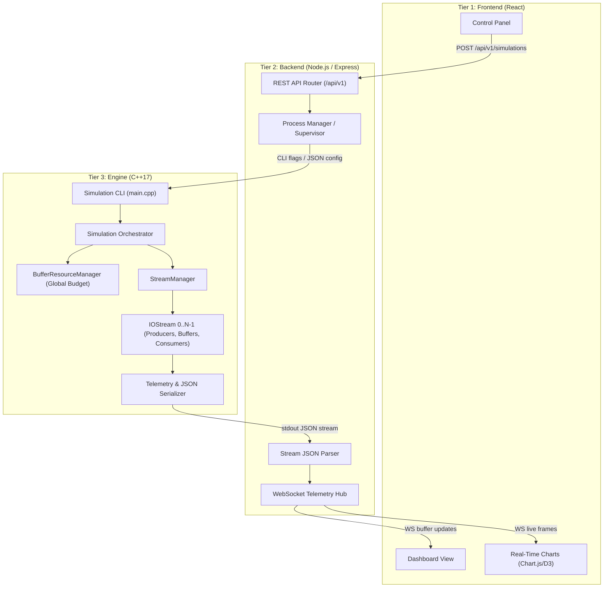
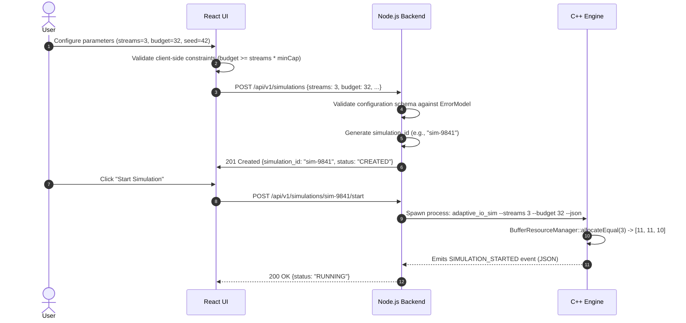
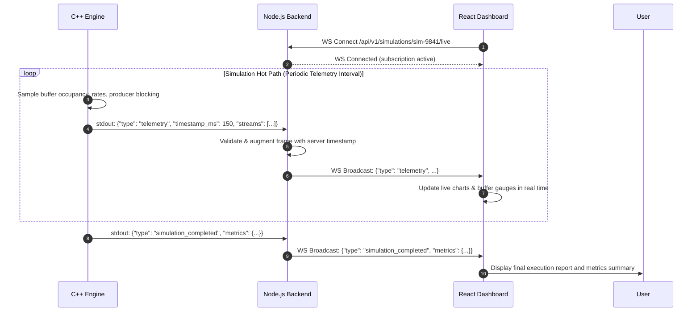
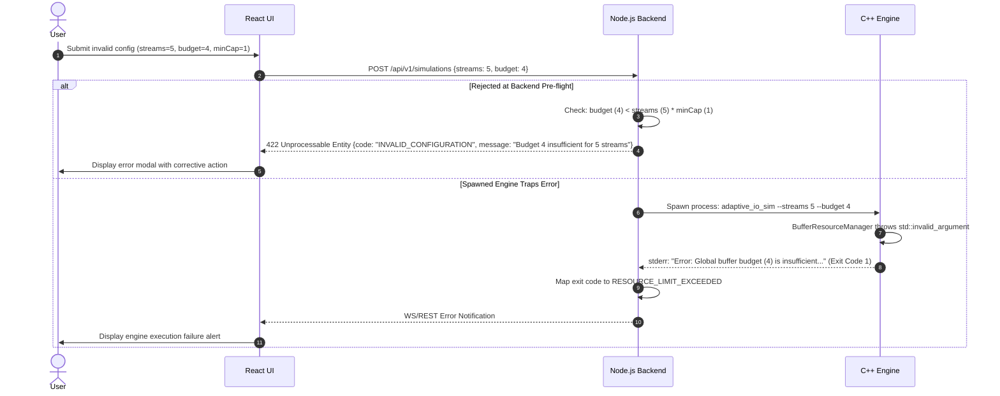

Phase 7: --adaptive enables physical resizing; --adaptive --telemetry adds buffer_resize outcome records. --json alone remains completion-only. See [runtime schema and behavior](RUNTIME_RESIZING_PHASE7.md).

Phase 5: --json remains completion-only; --telemetry emits metrics_snapshot NDJSON and completion. See [METRICS_PHASE5.md](METRICS_PHASE5.md). Runtime control/event features described below remain design contracts.

# Integration Contract & System Architecture
**Adaptive I/O Buffer Management & Performance Optimization System**
**Specification Version**: 1.0.0 (Phase 3 Foundation)

---

## 1. Executive System Overview

The system is designed as an end-to-end, full-stack Operating Systems Course Project. It decomposes into three distinct tiers:

```
+-------------------------------------------------------------+
|                      React Frontend                         |
|   (Interactive Dashboard, Live Graphs, Allocation Controls)|
+------------------------------+------------------------------+
                               |
                   HTTP / REST | WebSocket
                   JSON (v1)   | Live Telemetry Stream
                               |
+------------------------------v------------------------------+
|                     Node.js Backend                         |
|   (Process Supervisor, Orchestrator, REST/WS Gateway)      |
+------------------------------+------------------------------+
                               |
                   IPC / Stdio | Subprocess Control
                   JSON Stream | Posix Pipes / Stdin / Stdout
                               |
+------------------------------v------------------------------+
|                   C++ Simulation Engine                     |
|   (Concurrency Core, Bounded Buffers, Resource Manager)    |
+-------------------------------------------------------------+
```

### Architectural Principles & Decoupling Invariants
1. **Engine Independence**: The C++ simulation engine is fully standalone and can be executed, benchmarked, and verified directly via CLI without Node.js or React.
2. **Backend Independence**: The Node.js backend can orchestrate simulations, collect telemetry, validate configurations, and produce reports headlessly without the React frontend.
3. **Frontend Isolation**: The React frontend communicates **exclusively** with the Node.js backend via HTTP REST and WebSocket APIs. The frontend never executes or touches C++ binaries or OS primitives directly.
4. **Strict Data Serialization**: Terminal escape sequences and human-readable text logs are completely segregated from machine-readable JSON telemetry.

---

## 2. Component Responsibilities

| Tier | Component | Core Responsibilities | Prohibited Actions |
| :--- | :--- | :--- | :--- |
| **C++ Engine** | Concurrency & Resource Engine | • Preemptive thread scheduling (`std::thread`, mutexes, condition variables)<br>• Bounded circular buffers with strict FIFO invariants<br>• Global buffer budget enforcement via `BufferResourceManager`<br>• Real-time metric aggregation and JSON telemetry streaming | • Network sockets / HTTP server code<br>• Web framework dependencies<br>• Terminal-coupled output for telemetry |
| **Node.js** | Backend Gateway & Process Supervisor | • Spawns and manages C++ simulation child processes (`child_process.spawn`)<br>• Translates REST requests into simulation arguments/configs<br>• Parses NDJSON/JSON telemetry streams from C++ stdout/pipes<br>• Broadcasts live telemetry frames over WebSockets<br>• Manages simulation persistence and error logging | • Re-implementing concurrency algorithms<br>• Bypassing engine resource managers<br>• Coupling UI logic to C++ headers |
| **React** | Interactive UI Frontend | • Displays real-time buffer occupancy bar gauges and strip charts<br>• Visualizes per-stream throughput, latency, and producer wait times<br>• Provides simulation control forms (streams, budget, rates, seeds)<br>• Displays event timelines and explainability logs | • Direct process invocation<br>• Local IPC communication with C++ |

---

## 3. Communication Protocols & Data Flows

### 3.1 C++ ↔ Node.js IPC Protocol
* **Channel**: Standard Input / Standard Output (`stdio`) pipes and child process signals (`SIGTERM`, `SIGINT`).
* **Format**: Line-delimited JSON (NDJSON) for streaming telemetry; atomic JSON payload on exit.
* **Exit Codes**: Standardized process exit codes mapped to canonical `EngineErrorCode`.

### 3.2 Node.js ↔ React Protocol
* **Control Channel**: HTTP REST (`/api/v1/simulations/...`).
* **Streaming Channel**: WebSocket (`/api/v1/simulations/:id/live`).

---

## 4. End-to-End System Diagrams

### 4.1 Global Architecture & Component Interaction


### 4.2 Configuration Flow


### 4.3 Live Telemetry Flow


### 4.4 Error Flow


---

## 5. Canonical Data Models (Schema Specification)

All structures adhere to the canonical C++ types defined in `engine/include/DataModels.h` and serialize to the following JSON schemas.

### 5.1 `SimulationConfig`
```json
{
  "simulation_id": "sim-c198a4e",
  "num_streams": 3,
  "global_buffer_budget": 32,
  "min_buffer_capacity": 1,
  "buffer_capacity": 0,
  "num_requests": 1000,
  "producer_interval_ms": 5,
  "consumer_processing_ms": 10,
  "min_payload_bytes": 512,
  "max_payload_bytes": 4096,
  "random_seed": 42,
  "workload": {
    "type": "BURST",
    "base_interval_ms": 10,
    "burst_interval_ms": 1,
    "burst_length": 20,
    "normal_length": 80
  }
}
```

### 5.2 `BufferState`
```json
{
  "stream_id": 0,
  "capacity": 11,
  "occupancy": 3,
  "utilization_pct": 27.2727,
  "is_closed": false
}
```

### 5.3 `StreamState`
```json
{
  "stream_id": 0,
  "name": "Stream-0",
  "status": "RUNNING",
  "items_produced": 450,
  "items_consumed": 447,
  "buffer": {
    "stream_id": 0,
    "capacity": 11,
    "occupancy": 3,
    "utilization_pct": 27.2727,
    "is_closed": false
  }
}
```

### 5.4 `SimulationMetrics`
```json
{
  "type": "simulation_completed",
  "stream_count": 3,
  "workload_type": "HETEROGENEOUS",
  "global_buffer_budget": 32,
  "total_allocated_capacity": 32,
  "free_buffer_budget": 0,
  "min_buffer_capacity": 1,
  "total_produced": 3000,
  "total_consumed": 3000,
  "total_bytes": 6842100,
  "simulation_time_sec": 10.421,
  "throughput_req_per_sec": 287.88,
  "throughput_mb_per_sec": 0.625,
  "avg_latency_ms": 18.42,
  "min_latency_ms": 12.10,
  "max_latency_ms": 32.50,
  "total_producer_wait_ms": 142.5,
  "avg_producer_wait_ms": 0.0475,
  "avg_occupancy_slots": 2.85,
  "avg_occupancy_pct": 8.90,
  "max_occupancy_slots": 7,
  "max_occupancy_pct": 21.87,
  "success": true,
  "streams": [ ... ]
}
```

---

## 6. Proposed REST API Specification (`/api/v1/`)

| Method | Endpoint | Purpose | Request Body | Expected Response | Error Codes |
| :--- | :--- | :--- | :--- | :--- | :--- |
| `POST` | `/api/v1/simulations` | Create a new configured simulation instance | `SimulationConfig` JSON | `201 Created` with `{ "simulation_id": "...", "status": "CREATED" }` | `INVALID_CONFIGURATION`, `RESOURCE_LIMIT_EXCEEDED` |
| `GET` | `/api/v1/simulations/:id` | Fetch configuration and lifecycle metadata | None | `200 OK` with `SimulationState` | `SIMULATION_NOT_FOUND` |
| `POST` | `/api/v1/simulations/:id/start` | Launch child process and begin execution | None | `200 OK` with `{ "status": "RUNNING" }` | `SIMULATION_NOT_FOUND`, `SIMULATION_ALREADY_RUNNING`, `ENGINE_START_FAILURE` |
| `POST` | `/api/v1/simulations/:id/stop` | Terminate simulation gracefully | None | `200 OK` with `{ "status": "STOPPED" }` | `SIMULATION_NOT_FOUND`, `SIMULATION_NOT_RUNNING` |
| `GET` | `/api/v1/simulations/:id/state` | Poll current execution state | None | `200 OK` with `SimulationState` and per-stream status | `SIMULATION_NOT_FOUND` |
| `GET` | `/api/v1/simulations/:id/metrics` | Retrieve cumulative or final metrics | None | `200 OK` with `SimulationMetrics` | `SIMULATION_NOT_FOUND` |
| `GET` | `/api/v1/simulations/:id/events` | Fetch event log history | `?since_ms=<timestamp>` | `200 OK` with `[ SimulationEvent ]` | `SIMULATION_NOT_FOUND` |

---

## 7. Future WebSocket Live Telemetry Protocol

* **Endpoint**: `/api/v1/simulations/:id/live`
* **Transport**: WebSocket (JSON text frames)

### Message Types:
1. **`telemetry`**: High-frequency snapshot of throughput, latency, and occupancy.
   ```json
   {
     "type": "telemetry",
     "timestamp_ms": 10420,
     "simulation_id": "sim-9841",
     "active_streams": 3,
     "aggregate_throughput_req_per_sec": 288.4,
     "streams": [
       { "stream_id": 0, "occupancy": 4, "capacity": 11, "throughput": 96.1 },
       { "stream_id": 1, "occupancy": 3, "capacity": 11, "throughput": 96.2 },
       { "stream_id": 2, "occupancy": 2, "capacity": 10, "throughput": 96.1 }
     ]
   }
   ```
2. **`buffer_update`**: Emitted when a buffer state changes or upon reallocation.
   ```json
   {
     "type": "buffer_update",
     "timestamp_ms": 10425,
     "stream_id": 0,
     "capacity": 11,
     "occupancy": 5,
     "utilization_pct": 45.45
   }
   ```
3. **`event`**: Emitted when a canonical `SimulationEvent` occurs (e.g. `BUFFER_RESIZE_REQUESTED`).
4. **`simulation_completed`**: Final payload delivering complete `SimulationMetrics`.
5. **`simulation_error`**: Emitted on runtime failure with structured `EngineError`.

---

## 8. Error Model & HTTP Status Code Mapping

| EngineErrorCode | HTTP Status | Description | Trigger Scenarios |
| :--- | :--- | :--- | :--- |
| `INVALID_CONFIGURATION` | `400 Bad Request` | Missing or malformed parameters | Negative rates, min-payload > max-payload |
| `RESOURCE_LIMIT_EXCEEDED` | `422 Unprocessable Entity` | Buffer budget violated | Budget < streams * minCap, or sum(capacity) > budget |
| `SIMULATION_NOT_FOUND` | `404 Not Found` | Unknown simulation ID | ID does not exist in backend registry |
| `SIMULATION_ALREADY_RUNNING` | `409 Conflict` | Start request on active run | Calling `/start` on already active simulation |
| `SIMULATION_NOT_RUNNING` | `409 Conflict` | Stop request on idle run | Calling `/stop` when simulation is completed or idle |
| `ENGINE_START_FAILURE` | `500 Internal Server Error` | Child process launch failure | C++ executable not found or missing permissions |
| `ENGINE_RUNTIME_FAILURE` | `500 Internal Server Error` | Simulation crashed or aborted | Child process terminated via SIGSEGV or exit code 1 |
| `IPC_FAILURE` | `502 Bad Gateway` | Broken pipe or unparseable stdout | Corrupted JSON payload emitted by engine |
| `INVALID_REQUEST` | `400 Bad Request` | Malformed HTTP or WS message | Unrecognized command or invalid JSON request body |

---

## 9. Dynamic Buffer Resizing & Adaptive Control Contract (Phase 6 Preparation)

To guarantee that future Phase 6 adaptive optimization can be implemented seamlessly:
1. **Ownership**: `BufferResourceManager` exclusively owns global capacity accounting and invariant validation.
2. **Authorization**: Only the future `AdaptiveController` will have authority to request runtime reallocations.
3. **Validation Sequence**:
   - Controller queries stream occupancy and contention signals.
   - Controller calls `BufferResourceManager::canResize()` or `reallocate()`.
   - `BufferResourceManager` validates that $C_i \ge C_{\text{min}}$ and $\sum C_i \le B_{\text{total}}$.
   - If approved, `BufferResourceManager` updates its records and returns `true`.
   - `BoundedBuffer` adjusts its capacity boundary without discarding enqueued requests.
   - A `SimulationEvent` with type `RESOURCE_ALLOCATION_CHANGED` is emitted for telemetry streaming.
4. **Transparency**: The simulation core and worker threads never block on backend or UI processing during resize events.
