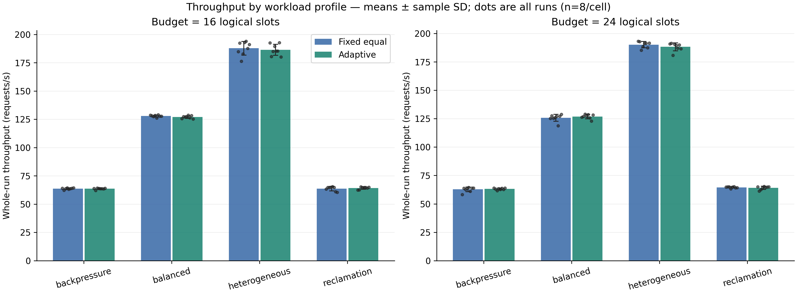
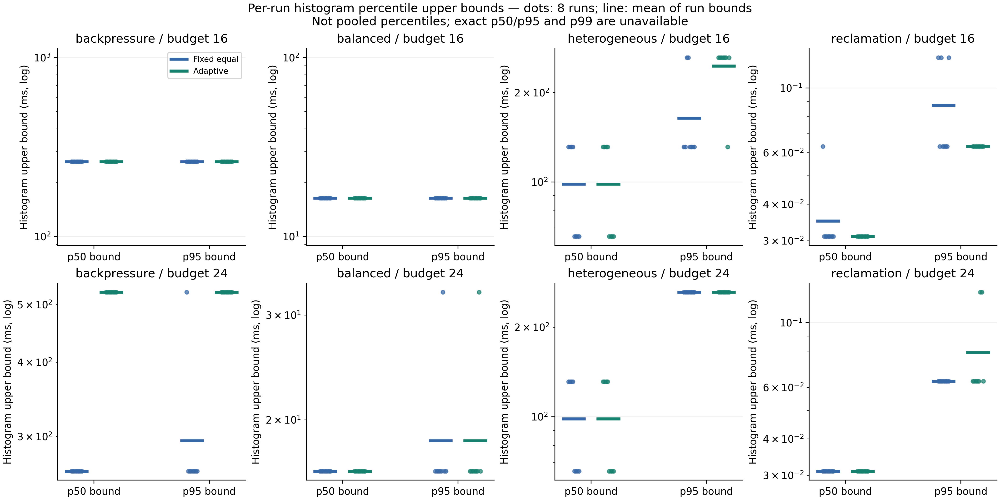
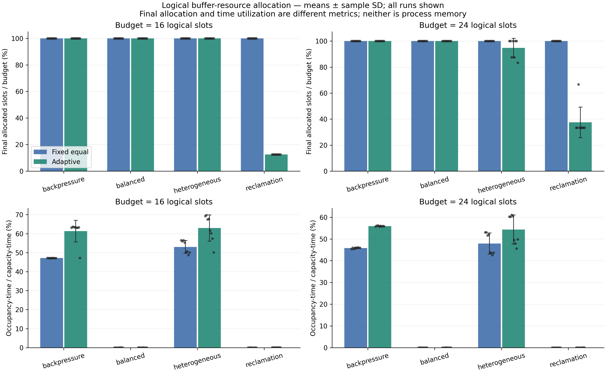

# Viva presentation — ready-to-present content

15 slides, approximately12–15 minutes plus a short demonstration. Detailed technical
references and tables are in [FINAL_REPORT.md](FINAL_REPORT.md); rehearse using
[VIVA_DEMO_GUIDE.md](VIVA_DEMO_GUIDE.md).

---

## Slide 1 — Adaptive I/O Lab

**Main content:** Bounded concurrent I/O streams; adaptive logical buffer allocation; evidence-driven evaluation.

**Visual:** Title and project identity.

**Speaker notes:** This is an OS simulation and observability project, not a real storage-driver benchmark.

---

## Slide 2 — Problem and motivation

**Main content:** Small queues block producers. Large queues reserve slots and can increase latency. Demand differs across streams.

**Visual:** Two streams sharing a fixed slot pool.

**Speaker notes:** Our question is how to redistribute capacity safely, not how to guarantee faster devices.

---

## Slide 3 — Objectives and boundaries

**Main content:** Preserve FIFO/counts/budget. Make recommendations explainable. Observe actual state. Reproduce comparisons.

**Visual:** Budget invariant: sum capacities <= B.

**Speaker notes:** The budget is logical slots. Payload sizes and actual process memory are separate.

---

## Slide 4 — Operating-system concepts

**Main content:** Producer-consumer synchronization; mutexes and condition variables; backpressure; thread lifecycle; IPC.

**Visual:** Producer -> bounded FIFO -> consumer.

**Speaker notes:** Producers block on full queues, consumers on empty queues. There is no busy-waiting queue loop.

---

## Slide 5 — Connected architecture

**Main content:** React -> Express -> trusted native child process -> NDJSON -> API polling -> React.

**Visual:** Architecture diagram in FINAL_REPORT.md section2.

**Speaker notes:** Native code is independent of Node/React. Backend state and native measurements have distinct authority.

---

## Slide 6 — Buffer and resource model

**Main content:** 0 <= occupancy <= capacity; sum capacities <= budget; per-stream bounds. Fixed equal and adaptive share initial allocations.

**Visual:** Resource accounting / physical queues / recommendation labels.

**Speaker notes:** API fixed preserves submitted capacities; CLI fixed_equal constructs capped equal initial allocations. Never conflate them.

---

## Slide 7 — Controller and physical resizing

**Main content:** Occupancy plus producer pressure; low-demand donors; confirming windows; cooldown; capped fair grants. Transactional FIFO-preserving application.

**Visual:** Snapshot -> recommendation -> guarded executor -> actual acknowledgement.

**Speaker notes:** Phase9 defaults are80/30% thresholds,3 confirming windows,4-slot steps,100ms update and500ms cooldown. Deferred recommendations are not successes.

---

## Slide 8 — Controlled experiment methodology

**Main content:** 128 runs;64 pairs;four profiles;budgets16/24;seeds42/101;four repeats. n=8 per strategy/cell.

**Visual:** Matrix schematic and nominal fingerprint matching.

**Speaker notes:** Pairs match configs, seeds and native input checksums. Runs are sequential/counterbalanced; no outliers trimmed or significance claimed.

---

## Slide 9 — Throughput results

**Main content:** Changes are small and mixed. Similar service limits persist. Bars are means; whiskers sample SD; dots all runs.

**Visual:** 

**Speaker notes:** Read within the same workload/budget. Balanced runs had no resizes; variation there is not evidence of physical adaptation benefits.

---

## Slide 10 — Latency and backpressure tradeoff

**Main content:** Backpressure latency rose23.703%/17.798% at budgets16/24 while producer waiting fell. Percentile summaries are histogram bounds.

**Visual:** 

**Speaker notes:** Mean latency covers creation through completion, including blocked producer time. Plotted p50/p95 bounds are not exact or pooled percentiles; p99 is unavailable.

---

## Slide 11 — Logical resource efficiency

**Main content:** Reclamation budget16 ended at2 allocated slots versus16 fixed in all8 adaptive runs. Other workloads retain more capacity.

**Visual:** 

**Speaker notes:** 87.5% logical budget slack at completion is not an RSS saving. Occupancy-time/capacity-time and endpoint allocation fraction are different measures.

---

## Slide 12 — Validation and sustained stress

**Main content:** Real native/backend/browser tests; Linux/Windows/macOS CI; Linux ASan/TSan/Valgrind. Original hour:828000 requests,207 batches,3107 applied resizes,exit0.

**Visual:** Phase14 evidence table in FINAL_REPORT.md section8.

**Speaker notes:** The hour lasted3603.466s with229.779req/s including a long batch. The separate3s burst achieved about740018req/s and must not replace the hour rate.

---

## Slide 13 — Limits and measurement honesty

**Main content:** Sleep-based service; scheduling variation;small seed corpus;bounded histograms;logical slots, not memory. Ephemeral history and bounded telemetry.

**Visual:** Evidence available / unavailable table.

**Speaker notes:** Hard-crash orphan containment and Windows interruption signals remain limitations. Sanitizer passes cover tested cases, not every possible future workload.

---

## Slide 14 — Conclusions and future work

**Main content:** Safe observed adaptation and reclamation; measurable waiting/latency tradeoffs; reproducible evidence. No universal speedup claim.

**Visual:** Three findings: mechanism, tradeoff, evidence.

**Speaker notes:** Future contracts could add persistence, stronger crash containment and request-level metrics. These are suggestions, not new delivered features or a Phase16.

---

## Slide 15 — Live demonstration and viva

**Main content:** Run fixed and adaptive;inspect real resize events;compare matched results;export CSV/JSON;cancel and shut down safely.

**Visual:** VIVA_DEMO_GUIDE.md and saved measured plots as fallback.

**Speaker notes:** Use the short demonstration. Do not run an hour test during the viva. Describe a fallback screenshot as recorded evidence, never as live telemetry.
